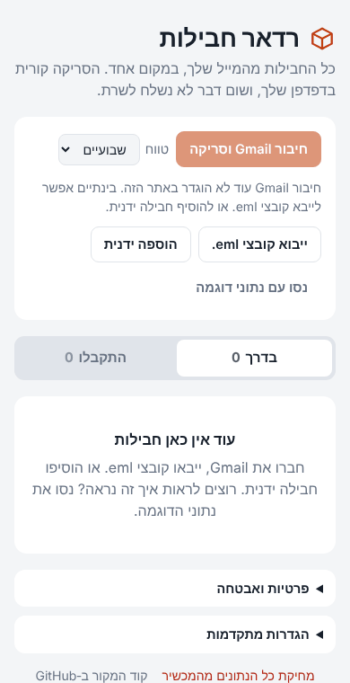
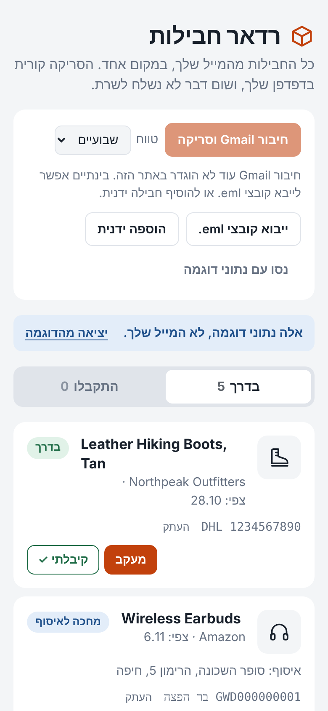
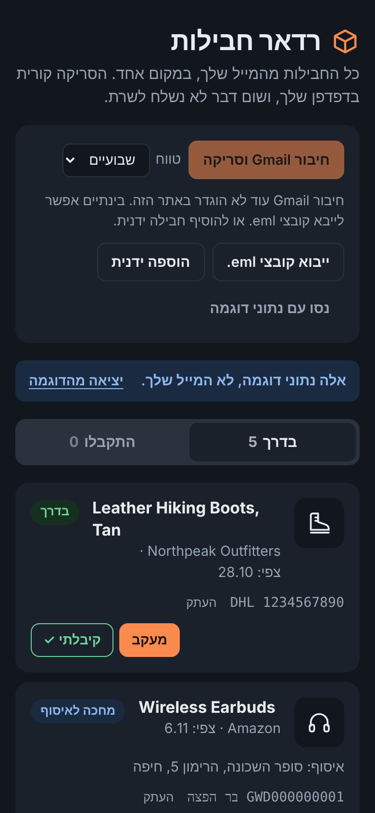

# Package Radar

**Every parcel in your inbox, in one place. Scanned in your browser, never on a server.**

[**Open the app →**](https://l1avzh.github.io/package-radar/) · MIT licensed · no build step, no dependencies

<p align="center">
  
</p>

Package Radar reads your shipping and order emails, pulls out the tracking number, status, item, expected arrival and pickup point, and shows each parcel as one card. When a parcel arrives, tap **"קיבלתי ✓"** (received) and it moves to its own tab. The interface is in Hebrew and right-to-left.

> All products, stores and tracking numbers in these screenshots are made up.

| Phone, light | Phone, dark |
|---|---|
|  |  |

## Features

- **Gmail scan** for the last week, two weeks, month or two months, with read-only access.
- **Recognises carriers and shops**: DHL, Aramex, UPS, FedEx, USPS, Israel Post and other UPU postal numbers, Bar Distribution, Cainiao, plus shop emails from Amazon, AliExpress, GOAT, Global‑e stores and more.
- **One card per parcel.** The order confirmation, the shop's "shipped" email and the carrier's notice are merged, and the status only moves forward.
- **Received tab.** Mark parcels as received to clear them from the main list.
- **No Gmail needed**: import `.eml` files (from iCloud, Outlook, Apple Mail…) or add a parcel by hand.
- **Light and dark themes**, works on phones, installable as a web app.

## Privacy and security

| | |
|---|---|
| Server | None. A static site on GitHub Pages. |
| Gmail permission | `gmail.readonly` only. The app cannot send, delete or change mail. |
| Access token | Kept in memory only, expires in about an hour. No refresh token. "Disconnect" revokes it at Google. |
| What is stored | Only short package summaries (item, shop, tracking number, status) in your browser's `localStorage`. Email bodies are never stored. One click deletes everything. |
| Network | A Content‑Security‑Policy limits requests to `gmail.googleapis.com` and Google sign‑in. Google's script loads only after you click "Connect". No analytics, cookies, web fonts or third‑party images. |
| Rendering | Email content is shown as text (`textContent`), never as HTML. Only `https:` links are rendered. |

Details: [SECURITY.md](SECURITY.md) · [PRIVACY.md](PRIVACY.md)

## Gmail connection: current status

Connecting Gmail needs a Google OAuth client ID. Because `gmail.readonly` is a *restricted* scope, Google limits unverified apps to 100 test users until the app passes Google's verification. Until then you can:

- use `.eml` import and manual entry, which need no Google account at all, or
- create your own client ID ([docs/google-setup.md](docs/google-setup.md)) and paste it under **"הגדרות מתקדמות"** (advanced settings). It is stored only in your browser.

## Run your own copy

1. Fork this repository, then go to **Settings → Pages** and set **Source: GitHub Actions**.
2. Create a Google OAuth client ID by following [docs/google-setup.md](docs/google-setup.md).
3. Put it in `src/config.js` (`GOOGLE_CLIENT_ID`). A client ID is not a secret.

Every push runs the tests and static security checks, then deploys.

## Development

```bash
npm test        # unit tests for the email parser (Node 20+, no dependencies)
npm run check   # static security checks
npm start       # local server at http://localhost:8080
```

```
index.html        page structure and Content-Security-Policy
styles.css        styles (light/dark, RTL)
src/app.js        UI and state
src/gmail.js      Google sign-in and Gmail API reads
src/parser.js     turns emails into packages (pure functions)
src/carriers.js   carriers, tracking-number patterns, tracking links
src/mime.js       MIME decoding for .eml files and Gmail API payloads
src/store.js      local storage
test/             tests with synthetic emails
```

**Adding a shop or carrier:** add a pattern in `src/carriers.js` or `src/parser.js`, add an example email with invented details to `test/fixtures.js`, and open a pull request.

## License

[MIT](LICENSE)
